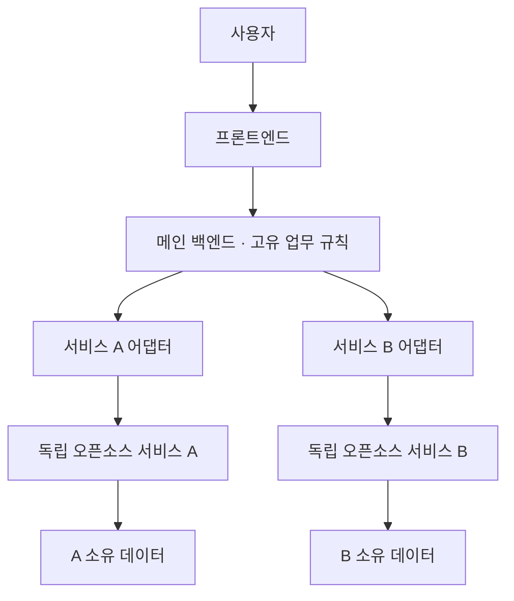

# OSS Composition Playbook

**기존 오픈소스를 독립 서비스로 조합하고, AI와 함께 필요한 기능을 만드는 아키텍처 지침서.**

> 상태: 공개 검토 초안 · v0.1.0-draft · 2026-10-17  
> 개발자 피드백을 반영한 뒤 정식 버전을 발행할 예정입니다. 실행 가능한 제품이나 검증이 끝난 운영 템플릿은 아닙니다.

## 제안

서비스에 필요한 모든 기능을 처음부터 작성하는 대신, 요구에 맞는 기존 오픈소스를 먼저 검토합니다. 채택한 소프트웨어는 가능한 한 독립된 서비스로 실행하고, 메인 백엔드에서 API 어댑터를 통해 연결합니다. 직접 개발은 서비스의 고유한 업무 규칙과 기존 도구로 충족하지 못하는 기능에 집중합니다.

AI 코딩 도구는 이 지침과 사용자의 요구사항을 읽고, 도구 선정·연결 설계·구현·검증을 수행합니다. 사용자는 목적과 제약을 결정합니다. 본 지침의 초기 대상 도구는 OpenAI Codex이며, 원칙 자체는 특정 모델의 능력이나 구독 조건에 의존하지 않습니다.

## 기본 구성

개발용 Codex는 이 구성을 작성하고 검증하는 도구입니다. 서비스 내부의 AI 조율 에이전트는 사용자의 요구에 따라 추가하는 별도 구성입니다. 모든 요청을 AI가 중계할 필요는 없습니다.

Docker Compose를 단일 호스트 기준의 기본 배포 방향으로 삼습니다. 컨테이너가 여러 개라는 이유만으로 장애·보안·자원 사용이 자동으로 격리되지는 않습니다.

## 누구를 위한 문서인가

- AI에게 서비스 개발을 맡기면서도 전체 구조의 방향을 정하고 싶은 사람
- 범용 기능을 반복 개발하는 대신 기존 소프트웨어를 연결하고 싶은 개발자
- 이 제안의 적용 범위와 실패 조건을 검토하려는 개발자

기능이 작고 기존 서비스가 제공하는 이점이 적다면, 통합 비용이 직접 개발 비용보다 커질 수 있습니다. 기능마다 독립 서비스를 하나씩 추가하라는 지침은 아닙니다.

## 시작하기

1. [아키텍처 제안](docs/architecture.md)을 읽습니다.
2. [AI 시작 지시문](prompts/start.md)을 AI에게 전달하고 서비스의 목적과 제약을 설명합니다.
3. AI가 작성한 도구 선정표와 구현 계획을 검토합니다.
4. 외부 서비스 하나를 연결하는 최소 흐름부터 구현하고 실패 동작까지 검증합니다.
5. [개발자 검토 항목](docs/review.md)을 기준으로 피드백을 남깁니다.

링크만으로 문서를 읽을 수 없는 AI 환경에서는 README, 아키텍처 문서, 시작 지시문을 직접 첨부합니다. 읽지 못한 문서를 읽었다고 가정하지 않습니다.

## 문서 안내

| 문서 | 내용 |
| --- | --- |
| [아키텍처](docs/architecture.md) | 구성, 필수 원칙, 선택 사항, 적용 한계 |
| [개발 절차](docs/workflow.md) | 요구사항부터 검증·배포까지 |
| [AI 시작 지시문](prompts/start.md) | 사용자가 복사해서 전달할 지시문 |
| [설계 기록 양식](docs/project-template.md) | 프로젝트별 결정과 서비스 선정 기록 |
| [검토·출시 기준](docs/review.md) | 피드백 질문과 정식 버전 조건 |
| [문서 작성 참고](docs/references.md) | 문서 형식을 참고한 자료 |
| [기여 안내](CONTRIBUTING.md) | 이슈와 수정 제안 방법 |

## 현재 검증 상태

이 초안에는 실행 예제와 성능 측정 결과가 없습니다. 특정 시스템에서 운영 안정성이나 교체 가능성을 입증한 것으로 해석하지 않습니다. 이번 검토의 대상은 제안의 일관성, 적용 조건, 빠진 설계 판단입니다.

독립 서비스와 API 사용은 교체를 쉽게 만드는 수단입니다. 데이터 이전, 업무 흐름, 인증, API 기능의 차이에 따라 교체 작업이 필요합니다. 연결을 끊었을 때 일부 기능이 멈출 수 있으므로 영향 범위와 대체 동작을 설계해야 합니다.

## 피드백과 배포

이 저장소는 공개 초안입니다. Issues와 Pull Requests로 개발자 검토를 받고, 주요 쟁점과 수정 내역을 기록한 뒤 v1.0.0을 발행합니다. 공개 저장소 작성과 정식 버전 발행은 구분합니다.

현재 배포물은 문서입니다. GitHub Pages 웹사이트, 설치 프로그램, 운영용 Compose 템플릿은 포함하지 않습니다.

문서 이용 조건은 [LICENSE](LICENSE)를 따릅니다. 이 문서가 소개하거나 향후 연결할 외부 소프트웨어에는 각각의 라이선스가 적용됩니다.
